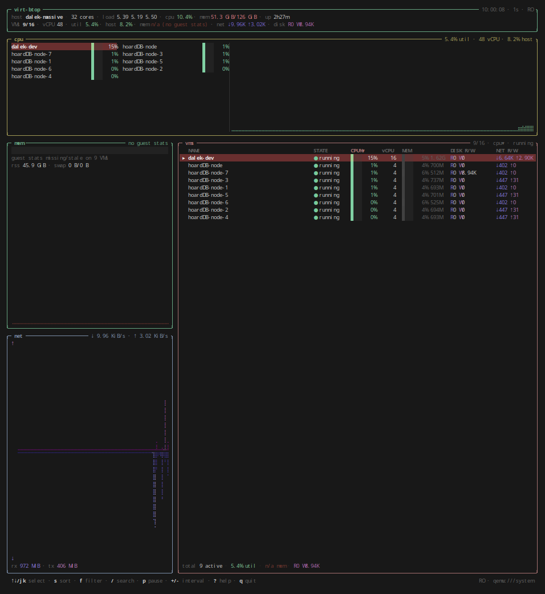

# virt-btop

A **btop-style TUI for libvirt/KVM virtual machines**. It reads libvirt
directly through `libvirt.org/go/libvirt` — no `virsh` subprocess and no text
parsing — and lays the data out like btop:

- a full-width **CPU box** with the running VMs where btop lists cores, plus a
  combined braille graph of vCPU utilization;
- a **memory box** and a **network box** for the combined guest totals on the
  left;
- a **VM list** where btop shows processes, with per-VM CPU, memory, disk I/O,
  and network I/O;
- btop's muted palette, pale box borders (green header/mem, yellow CPU, blue
  network, red VM list), and filled Unicode braille area graphs (U+2800–U+28FF);
  the memory and network graph colors are 30% brighter than btop's defaults.
- running VMs by default; press `f` to include paused, stopped, or all VMs.

Read-only by default: on Debian/Ubuntu this needs **no sudo and no libvirt
group**. An opt-in read-write connection enables guest-agent IP addresses.

## Screenshot



## Requirements

- Linux with libvirt and a QEMU/KVM driver.
- Go **1.24+** and `gcc`/cgo at build time.
- The libvirt runtime library (`libvirt.so.0`); it is already present on any
  host running libvirt.

You do **not** need `libvirt-dev` headers when building with the
`libvirt_dlopen` tag: the bindings `dlopen("libvirt.so.0")` at runtime. The
resulting binary still links libc (cgo), so a fully static pure-Go binary is
not possible with libvirt-go.

## Build

```sh
git clone <this repo>
cd virt-btop
make build
./bin/virt-btop
```

If `go` is not on your `PATH` (for example, a tarball installed under
`~/.local/go`), add it first:

```sh
export PATH="$HOME/.local/go/bin:$PATH"
```

Equivalent direct command:

```sh
CGO_ENABLED=1 go build -tags libvirt_dlopen -o bin/virt-btop ./cmd/virt-btop
```

Install into `$GOBIN`:

```sh
CGO_ENABLED=1 go install -tags libvirt_dlopen ./cmd/virt-btop
```

If you prefer linking against libvirt at build time and have `libvirt-dev`
installed:

```sh
make build-linked
```

## Permissions

| Connection | Requirement |
|---|---|
| `qemu:///system`, read-only (default) | None on default Debian/Ubuntu policy. Uses `/run/libvirt/libvirt-sock-ro` and the `org.libvirt.unix.monitor` polkit action. |
| `qemu:///system`, `--read-write` | User must be in the `libvirt` group (same as `virsh`): `sudo usermod -aG libvirt $USER`, then log out and back in. |
| `qemu:///session` | Sees only the current user's session VMs. No group needed. |

`LIBVIRT_DEFAULT_URI` is respected. If a read-write connection is denied, the
error message includes the group hint.

## Usage

```
virt-btop [flags]

  -c, --connect URI      libvirt URI (default: $LIBVIRT_DEFAULT_URI or qemu:///system)
  -i, --interval DUR    poll interval, e.g. 1s or 500ms (250ms–10s, default 1s;
                         values outside the range are rejected, not clamped)
      --read-write       read-write connection (guest-agent IPs; libvirt group required)
      --sort KEY         initial sort: cpu, mem, name, disk, net, state (default cpu)
      --filter NAME      initial filter: all, running, paused, stopped (default running)
      --once             take two samples, print a text table, exit
      --version          print version and exit
```

Useful examples:

```sh
virt-btop                              # read-only, qemu:///system
virt-btop -c qemu:///session           # your session VMs only
virt-btop --read-write                 # guest-agent interface addresses
virt-btop --filter all                 # include paused and stopped VMs
virt-btop --once -i 500ms              # scriptable one-shot table
virt-btop --once --filter stopped      # stopped VMs only
virt-btop --sort mem --filter running
```

## Keys

| Key | Action |
|---|---|
| `↑`/`↓`, `k`/`j` | select VM |
| `PgUp`/`PgDn`, `Home`/`End` | page / first / last |
| mouse click / wheel | select / scroll |
| `s` | cycle sort |
| `1`…`6` | sort cpu / mem / name / disk / net / state |
| `r` | reverse sort |
| `f` | filter all / running / paused / stopped |
| `/` | search by name (`Enter` apply, `Esc` clear) |
| `p` or `Space` | pause sampling |
| `+` / `-` | increase / decrease poll interval |
| `R` | refresh cached VM metadata and interface addresses |
| `Enter` | open VM detail overlay |
| `?` | help |
| `q` / `Ctrl-C` | quit |

The detail overlay shows per-vCPU utilization, a per-VM CPU graph, memory
breakdown, disk capacities, host-side interfaces, and IP addresses when
available. The minimum terminal size is **130×21**; smaller terminals show a
resize message.

## Metrics

- **CPU%** (per VM) = guest CPU-time delta / interval / allocated vCPUs.
  A 16-vCPU VM at 50% is using 8 cores' worth of its allocation.
- **util** (CPU box graph and header) = weighted vCPU utilization across
  running/blocked VMs: total CPU-time delta / total allocated vCPUs. Paused and
  stopped VMs are excluded. The memory box still includes paused VMs because
  they hold guest memory, even when they are hidden from the list.
- **host** (in the CPU box) = the same CPU time as a percentage of all host
  cores. The header's `cpu` is the whole host's busy time from `/proc/stat`;
  `guest`/`guest_nice` jiffies are not counted twice (they are already inside
  `user`/`nice`).
- **mem** = guest used = configured memory − `balloon.usable` (the guest kernel's
  MemAvailable), falling back to `balloon.unused`. This is **not**
  `current − available`: libvirt's `available` is the total memory the guest
  sees, which is constant, so that difference never moves with load. RSS is the
  host qemu process RSS and is always accurate; it is shown separately.

### Guest memory statistics need a stats period

libvirt only refreshes guest memory statistics when the domain's memballoon has
a stats period. Without one, libvirt keeps returning whatever the balloon driver
last pushed, possibly hours ago, with no error. virt-btop therefore checks
`balloon.last-update` and never presents such numbers as live:

| Status | Meaning | List `MEM` column | Aggregates (mem box, header) |
|---|---|---|---|
| fresh | updated within 60 s | normal bar + usage | included |
| stale | last update older than 60 s | muted bar and text | excluded |
| unknown | no guest statistics at all (no balloon driver, or never updated) | `— no stats` | excluded |

The mem box and header say how many VMs are reporting (`3/9 VMs`), or
`no guest stats` when none are. The detail overlay shows how old stale numbers
are. To get live guest memory, enable the period on each VM (this changes the VM
and needs read-write access, so virt-btop will never do it for you):

```sh
virsh dommemstat <vm> --period 5 --live --config
```

or add `<stats period='5'/>` inside the VM's `<memballoon>` element.
- **net** = host-side vnet RX/TX. Graphs auto-scale to the peak in the visible
  window; totals are cumulative since VM start.
- **disk** = aggregate guest block-device read/write rates. The detail overlay
  shows per-disk capacity, allocation, and cumulative I/O.
- **IPs**: read-only mode uses ARP and DHCP-lease sources. `--read-write` tries
  the qemu guest agent first, then falls back.
- Interface lookups (detail overlay) are cached for 30 s, failures included, so
  a persistent error is not retried every poll; stopped VMs are not queried.
- Guest load averages are not available in read-only mode (libvirt forbids
  `virDomainGetGuestInfo`); the CPU numbers are instantaneous utilization.

## Layout

- CPU box: running/blocked VMs (top N by CPU) where btop lists cores, plus the
  combined filled braille graph. Paused and stopped VMs are hidden from the list
  by default; `f` cycles running → paused → stopped → all.
- Left column: combined memory and network.
- Right: the VM list (running VMs by default; `f` includes paused/stopped/all),
  with sortable CPU / memory / disk / network columns. The `NET` column appears
  when the terminal is wide enough.
- At 130×21 the CPU box has two VM columns, mem/net show compact graphs, and
  the list shows seven VMs without a totals row. Taller terminals add the
  totals row, RSS line, more graph rows, and all VM columns.

## Development

```sh
make test     # unit tests; most use fake data, the reconnect test uses local libvirt
make vet
make fmt
```

The build uses `-tags libvirt_dlopen` so tests and builds work without
`libvirt-dev`. The tests cover rate math, the memory fresh/stale/unknown model,
`/proc` parsing, libvirt stat conversion, error classification, formatting,
braille drawing, exact terminal width/height (including hostile VM names),
sorting/filtering/search, mouse selection, overlay geometry, and CLI validation.

`TestReconnectAfterConnectionLoss` runs the real client against a small proxy in
front of libvirt's read-only socket, kills the proxy, brings it back, and checks
that `Collect` recovers. It is skipped when no local libvirt is available. Also
useful before a release:

```sh
CGO_ENABLED=1 go test -race -tags libvirt_dlopen ./...
go run honnef.co/go/tools/cmd/staticcheck@latest -tags libvirt_dlopen ./...
```

## Limitations

- Monitoring only: no start/stop/reboot actions.
- Read-only mode cannot query the guest agent, so interface names/IPs may be
  incomplete or stale (ARP/lease best effort).
- Some libvirt drivers do not report every stat; missing guest memory is shown
  as unknown, never as zero or 100%.
- libvirt calls cannot be cancelled. If libvirtd hangs, the footer reports
  `libvirt not responding`, and quitting waits at most 2 s for the connection to
  close before exiting. If the connection dies (for example libvirtd restarts)
  the next poll reconnects automatically; the footer shows errors until it does.
- The qemu guest agent is required for guest-side interface names under
  `--read-write`.

## License

GPL-3.0. See [LICENSE](LICENSE).
